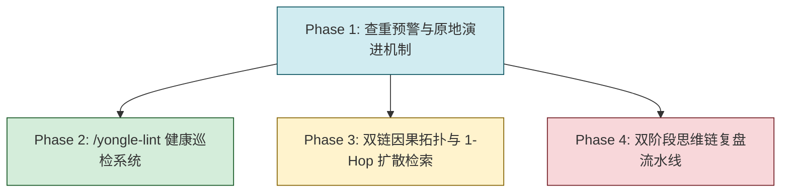

# 永乐大典 (Yongle Dadian) 升级演进规划方案 (PLAN.md)
> **吸收 LLM Wiki 核心设计哲学，迈向自演化工程智能体**

---

## 1. 升级背景与核心诉求

### 1.1 背景
**永乐大典 (`yongle-dadian`)** 已经建立了极其坚实的底层架构：标准 Markdown 物理层、SQLite FTS5 + LanceDB 本地向量双引擎、RRF 融合重排、四级配置覆盖以及 Git 云端同步。

然而在长期实战中，传统的“追加式经验沉淀”面临以下瓶颈：
1. **知识冲突与版本断层**：当同一技术栈（如 Vite、React、Windows 脚本）由于依赖升级导致旧解法失效时，系统会生成互相矛盾的新旧两条经验（KI），导致后续 Agent 检索时面临“二义性困境”。
2. **缺乏自愈与巡检（Wiki Rot）**：条目只增不减，缺乏主动巡检手段，容易积累过时、失效甚至矛盾的经验。
3. **经验孤岛化（Flat Knowledge）**：工程问题通常具备强因果链路（如“参数超长” $\to$ “子进程超时” $\to$ “IPC静默断连”），平铺的条目缺乏网状推理能力。

### 1.2 借鉴自 LLM Wiki 的核心思想
1. **知识持续编译（Persistent Compilation）**：知识在写入时就完成预消化与消歧，而非每次检索时临时推理。
2. **原地合并与演化（Page Merge & In-place Evolution）**：单一事实源（Single Source of Truth），冲突显式消解。
3. **闭环健康巡检（Lint & Self-healing）**：确定性结构体检 + 语义矛盾审计。
4. **双链关联与图谱扩散（Wikilinks & 1-Hop Expansion）**：通过双向链接构建故障因果网络。

### 1.3 核心底线原则（不做妥协）
- ❌ **坚决不做重型 GUI**：恪守轻量、毫秒级、Headless、Agent-Native 与终端优先。
- ❌ **坚守人机确认门禁**：保留 `/yongle-confirm` 人工审核，研发经验宁缺毋滥，严防垃圾生成。

---

## 2. 总体演进路线图 (Phase Roadmap)



---

## 3. 分阶段实施规划

### Phase 1: 查重预警与原地演进机制 (In-place Evolution)
**目标**：消除知识条目冲突，支持“原地更新、版本追踪与显式废弃”，而非无脑追加新文件。

#### 1. 架构设计与改动点
* **查重嗅探（Duplicate Sniffing）**：
  - 在 `/yongle-postmortem` 生成草稿前，以提取的核心报错和摘要作为 Query，调用内置的 `hybrid-search` 检索当前库（全局与项目库）。
  - 若 Top-1 匹配度的相似度超过阈值（如 Cosine 相似度 > 0.82 或 RRF 评分极高），判定为**高概率重合条目**。
* **草稿演进策略（Evolution Strategy）**：
  在生成的草稿 Frontmatter 中引入演进控制字段：
  ```yaml
  ---
  title: "..."
  type: Bug
  evolution_strategy: supplement # 可选: create_new | supplement | supersede
  target_ki: "KI-2026-05-0012"   # 关联的旧条目文件名或ID
  conflict_note: "旧方案在 Node 22 下已失效，补充 ESM 专属配置"
  ---
  ```
* **确认阶段原地合流 (`scripts/yongle-confirm.js`)**：
  - 若策略为 `supplement`（补充增量）：自动向 `target_ki` Markdown 追加版本迭代小节，更新 `updated_at`。
  - 若策略为 `supersede`（推翻废弃）：将旧条目 Frontmatter 标记 `status: deprecated`、`superseded_by: [新KI]`，新条目标记 `supersedes: [旧KI]`。
  - 触发数据库（SQLite + LanceDB）的原地 Upsert。

#### 2. 交付成果与验收标准
- [ ] 相同 Bug 二次复盘时，系统能主动列出可能重复的历史条目供开发者决策。
- [ ] 支持原地补充与废弃旧方案，检索时优先呈现最新结论并明确标注旧方案弃用原因。

---

### Phase 2: 自动化健康巡检系统 (`/yongle-lint`)
**目标**：实现对全库经验的静态与语义双重体检，防止知识库“腐化（Wiki Rot）”。

#### 1. 架构设计与改动点
* **新增命令与核心脚本**：
  - 核心执行脚本：`scripts/yongle-lint.js`
  - 指令说明文档：`commands/yongle-lint.md`
  - Skill 封装：`skills/yongle-lint/SKILL.md`
* **双层巡检逻辑**：
  1. **Layer 1: 确定性结构检查（Fast Rule-based）**：
     - 检查 YAML Frontmatter 缺失/破损（如缺少 type、tags、date）。
     - 检查物理 Markdown 存在但 SQLite/LanceDB 中丢失索引的“未挂载孤儿条目”。
     - 检查死链：正文中引用的 `[[KI-xxxx]]` 对应目标文件是否存在。
  2. **Layer 2: 语义矛盾与冗余审计（Semantic Audit，支持 `--deep` 参数）**：
     - 借助已有的向量相似度矩阵，扫描距离过近但未建立关联的潜在重复条目。
     - 识别被标记为 `deprecated` 的废弃条目，并建议是否归档到 `archive/` 目录。
* **CLI 交互输出**：
  提供整洁的终端输出面板，支持 `--fix` 自动修复已知的简单格式与索引同步问题。

#### 2. 交付成果与验收标准
- [ ] 运行 `/yongle-lint` 能够在秒级内扫描出格式破损条目与索引缺失条目。
- [ ] 运行 `/yongle-lint --fix` 能自动修复基础语法异常并触发增量重建索引。

---

### Phase 3: 双链因果拓扑与 1-Hop 扩散检索 (Wikilinks & Cause-Effect Graph)
**目标**：将离散的经验点连接为“故障因果树”，在检索时提供全链路上下文支持。

#### 1. 架构设计与改动点
* **Markdown 双链规范标准化**：
  - 规范在条目正文或 `related` 字段中使用 `[[KI-xxxx: 简要描述]]` 语法。
  - 例如在记录“前端静默超时”的条目中，关联 `[[KI-2026-04-0015: Windows命令行字符截断导致子进程挂起]]`。
* **检索扩散器改造 (`scripts/hybrid-search.js`)**：
  - 现有的 `hybridSearch()` 在产出 Top-K 结果后，新增 **1-Hop 关联扩散机制**：
    - 读取 Top 结果中的 `[[wikilink]]` 目标；
    - 若关联条目未在 Top-K 中，将其作为“因果背景知识（Causal Context）”一同附带输出，并在前端打上 `[因果关联延伸]` 标识。
* **防扩散泛滥约束**：
  - 仅扩散 1-Hop，最大追加数量不超过 2 条，避免 Context 爆炸。

#### 2. 交付成果与验收标准
- [ ] 条目正文规范支持 `[[wikilink]]` 语法。
- [ ] `/yongle-search` 检索命中某一深层报错时，能自动带出其根因前置条目，极大提升 Agent 诊断效率。

---

### Phase 4: 双阶段思维链复盘流水线 (Two-Step CoT Postmortem)
**目标**：彻底解决长会话复盘时的幻觉、冗长废话以及根因遗漏问题。

#### 1. 架构设计与改动点
* **流水线解耦 (`workflows/yongle-postmortem.md` & `skills/yongle-postmortem/SKILL.md`)**：
  - **Stage 1 (纯归因与试错分析 - Reasoning Pass)**：
    - 针对对话上下文，专注于梳理：
      1. 触发报错的代码与环境精确边界；
      2. 过程中被证实无效的尝试方案（避坑关键）；
      3. 最终生效的核心修正与底层根因。
    - 不要求输出任何格式化 Markdown，完全释放模型的归纳推理能力。
  - **Stage 2 (结构化编译与元数据对齐 - Compilation Pass)**：
    - 接收 Stage 1 的清晰事实；
    - 对齐现有的 Tag 标准规范与分类体系；
    - 生成标准的 YAML Frontmatter、可执行代码最小复现/修复块，以及推荐的 RRF 搜索关键词。

#### 2. 交付成果与验收标准
- [ ] `/yongle-postmortem` 提炼出的经验信噪比大幅提升，彻底杜绝模糊泛化的“空洞总结”。

---

## 4. 实施优先级与任务拆解清单 (Action Items)

| 阶段 | 任务名称 | 关键责任文件 | 预估复杂度 |
| :--- | :--- | :--- | :--- |
| **P1** | 查重嗅探逻辑接入 postmortem | `scripts/yongle-postmortem.js` / workflows | 中 |
| **P1** | confirm 脚本支持 supplement 与 supersede 原地演进 | `scripts/yongle-confirm.js` | 中 |
| **P2** | 开发 yongle-lint 结构化巡检核心逻辑 | `scripts/yongle-lint.js` (新建) | 中 |
| **P2** | 封装 /yongle-lint CLI 与 Skill 规范 | `commands/yongle-lint.md`, `skills/` | 低 |
| **P3** | 正文提取 [[wikilinks]] 正则与规范化 | `scripts/lib/metadata-utils.js` | 低 |
| **P3** | hybrid-search 接入 1-Hop 关联条目补充 | `scripts/hybrid-search.js` | 中 |
| **P4** | 改造 postmortem 提示词为双阶段 CoT 架构 | `workflows/yongle-postmortem.md` | 低 |

---

## 5. 总结与后续交付指令

本方案在保持 **永乐大典** 极简、轻量、高响应度的核心基因不变的前提下，完整吸收了 **LLM Wiki** 关于“知识编译、原地合并、自动化巡检、拓扑双链”的先进思想。

**建议后续在 `yongle-dadian` 工程中直接让 Agent 按照上述 Action Items，从 Phase 1 开始逐步推进落地。**
