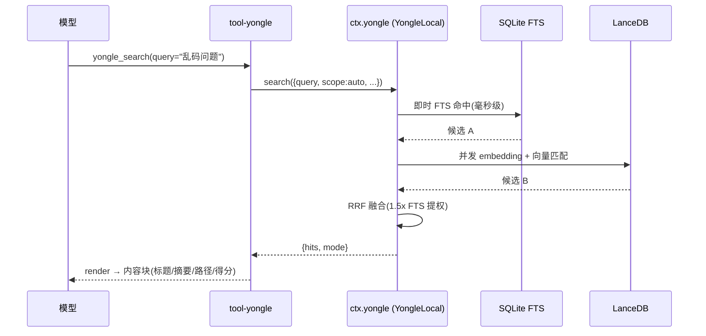
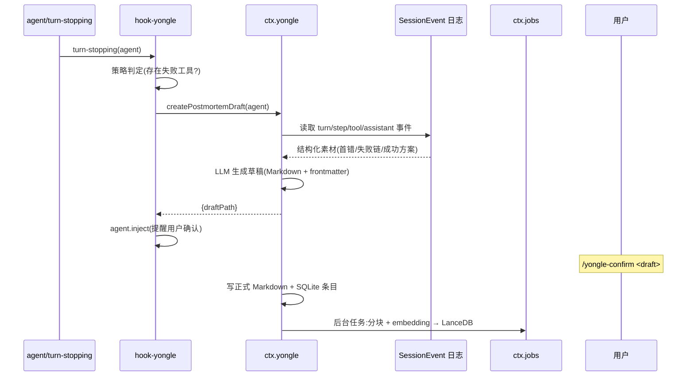

# 永乐大典 × DeepSeek Harness 原生集成方案

> 版本:v0.2(实施中) · 更新:2026-08-13 · P0-P2 已落地(见 §5 状态表)
> 配套文档:[DeepSeek-Harness-插件开发指南.md](./DeepSeek-Harness-插件开发指南.md)
> 官方参考:DeepSeek Harness 开发文档 <https://deepseek-harness.github.io/deepseek-harness/develop/basic/>

---

## 目录

- [1. 背景与目标](#1-背景与目标)
- [2. 总体架构](#2-总体架构)
- [3. 分层设计](#3-分层设计)
- [4. 数据流](#4-数据流)
- [5. 实施路线图](#5-实施路线图)
- [6. 风险与注意事项](#6-风险与注意事项)
- [7. 参考文档](#7-参考文档)

---

## 1. 背景与目标

### 1.1 为什么集成

调研结论(见上一轮对比分析):

- **DeepSeek Harness(DSH)没有内置知识库/语义检索**:仓库中不存在任何 memory / knowledge / embedding / vector 包。它提供的是"记忆基础设施"——会话日志全量持久化(`ctx.sessions` + persistence)、会话关键词检索(`ctx.sessionQuery` + opt-in 的 `tool-session-query`)、Skills 知识单元、上下文压缩(compaction)。
- **永乐大典的优势恰好是 DSH 的空白**:知识蒸馏(复盘草稿 → 人工确认 → 归档)、混合语义检索(SQLite FTS + LanceDB 向量 + RRF 融合)、跨宿主机通用、Git 多机同步。
- **两者互补而非竞争**:DSH 负责"记录一切 + 上下文管理",永乐大典负责"蒸馏 + 语义召回"。原生集成 = 把永乐大典做成 DSH 的插件/组合包,让两种能力在运行时内部无缝协作。

### 1.2 集成目标

| # | 目标 | 验收标准 |
|---|---|---|
| G1 | 永乐大典检索能力以**原生工具**形式供 DSH 模型调用 | `yongle_search` / `yongle_recall` 出现在提示词 schema 中,结果渲染为内容块与 UI 卡片 |
| G2 | 复盘/归档以**人类命令**形式提供 | `/yongle-postmortem`、`/yongle-confirm` 等由 `ctx.commands` 分派,不成为模型消息 |
| G3 | 复盘素材升级为**结构化会话日志** | postmortem 直接从 `SessionEvent` 日志提取,而非扫描宿主上下文 |
| G4 | 支持**自动触发**复盘(可选) | 监听 `agent/turn-stopping` / 工具错误事件,按策略自动生成草稿(保留人工确认) |
| G5 | 一键安装分发 | 打包为 `dsh.bundle`,`dsh plugin --profile <name> add` 即可启用 |
| G6 | 与现有能力共存 | 保留永乐大典对 Antigravity/Claude/Cursor 等宿主的命令注入;保留离线降级(纯 FTS) |

### 1.3 非目标(本期不做)

- 不替代 DSH 的 `tool-session-query`(原始会话检索归 DSH,蒸馏知识检索归永乐大典)。
- 不把 LanceDB 换成其他向量库;不改变永乐大典的存储格式(`~/.yongle_knowledge`、`.planning/yongle/memory/`)。
- 不做知识库的 Web UI 改造(沿用现有 CLI 与命令)。

---

## 2. 总体架构

### 2.1 角色映射(实施采用单包方案)

> **实施更新(2026-08-13)**:原计划按 seam 三角色拆分 5 个包,实际落地为
> **单个组合包 `yongle-dadian-dsh`**(永乐大典仓库 `dsh/` 目录)。理由:① 用户
> 优先"易上手/无感"——一条 `dsh plugin add` 装完;② 永乐大典是单一能力,无需
> 独立演进;③ 避免多包间共享核心引擎的路径耦合。DSH 官方允许一个包承担多个
> 角色(如 `dsh-llm` 同时是 Definition + Consumer)。

| DSH 角色 | 落地位置(单包内模块) | 职责 |
|---|---|---|
| Service Definition/Provider | `dsh/src/util.js`(核心门面) | 复用 `scripts/core` 进程内引擎(FTS5 + LanceDB + RRF),配置合并 + 自动建索引 |
| Consumer:工具 | `dsh/src/tools.js` | `yongle_search` / `yongle_recall` / `yongle_status` |
| Consumer:命令 | `dsh/src/commands.js` | `/yongle-search` / `/yongle-reindex` / `/yongle-status` |
| Consumer:钩子 | `dsh/src/hooks.js` | 回合内工具失败时注入极短检索提醒(默认关) |
| 组合包 | `dsh/package.json`(`dsh.bundle`) | 一键安装 |

**运行时依赖策略**:零 `@deepseek-ai/cordis` 运行时依赖(不继承 Service 基类 →
无 pnpm 双包陷阱);唯一运行时依赖 `@deepseek-ai/schemastery`(纯校验,鸭子类型
兼容);检索引擎经 `yongle-dadian` 包引用(发布后从 npm 安装,本地开发 `file:..`)。

```
┌─────────────────────────────────────────────────────────────────┐
│                     DSH 运行时 (Cordis 插件树)                    │
│                                                                   │
│  ┌────────────────────────────────────────────┐                  │
│  │  yongle-dadian-dsh (单组合包,一行 apply)    │                  │
│  │  ├─ tools.js    yongle_search/recall/status │                  │
│  │  ├─ commands.js /yongle-search|reindex|...  │                  │
│  │  └─ hooks.js    agent/turn-stopping 提醒    │                  │
│  └──────────────────┬─────────────────────────┘                  │
│                     │ import yongle-dadian/scripts/core           │
│                     ▼                                             │
│         进程内核心:SQLite FTS5 + LanceDB(连接复用) + RRF           │
│         (~/.yongle_knowledge 与 .planning/yongle)                 │
│  ┌──────────────────────────────┐                                 │
│  │ DSH 会话日志(ctx.sessions /   │ 复盘素材来源(下一版本接入)       │
│  │ sessionQuery, SessionEvent)  │                                 │
│  └──────────────────────────────┘                                 │
└─────────────────────────────────────────────────────────────────┘
```

### 2.2 与 DSH 内置能力的分工边界

| 关注点 | 归谁 |
|---|---|
| 会话事件记录、回放、续跑、fork | DSH(不动) |
| 会话原始日志的关键词检索、血缘追踪 | DSH `ctx.sessionQuery`(不动) |
| 知识蒸馏(复盘模板、条目 frontmatter) | 永乐大典 |
| 语义检索(FTS+向量+RRF) | 永乐大典 |
| 知识存储(Markdown + SQLite + LanceDB) | 永乐大典(格式不变) |
| 工具 schema 注入、UI 卡片、命令系统、后台任务、配置 | DSH(通过插件接入) |
| 多机 Git 同步、调度器、对非 DSH 宿主的注入 | 永乐大典(保留) |

### 2.3 仓库布局(已实施)

```
dsh/                        # 永乐大典 DSH 组合包(已实现,已安装到 web profile)
├── package.json            # dsh.bundle 声明 + 依赖(schemastery / yongle-dadian)
├── cordis.patch.yml        # 插件行:yongle-dadian-dsh
├── README.md               # 安装与配置说明
└── src/
    ├── index.js            # 插件入口:name/inject/Config/apply
    ├── tools.js            # 模型工具(检索/召回/状态)
    ├── commands.js         # 人类命令
    ├── hooks.js            # 自动提醒钩子
    └── util.js             # 配置合并 + 作用域解析 + 核心门面

scripts/core/               # 进程内检索引擎(已实现,CLI 与插件共用)
├── paths.js  db.js  lance.js  embed.js  cache.js  search.js  render.js  index.js
```

前提工作(阶段 0)已同步完成:`scripts/yongle-hybrid-search.js` 等 CLI 已改为
薄壳调用 `scripts/core`(进程内 SQLite FTS5 + LanceDB 连接复用),旧行为兼容。

### 2.4 三级知识库(已实现)

| 级别 | 语义 | 存储位置 | 启用方式 |
|---|---|---|---|
| `project`(项目级) | 当前工作区专属,随项目 git 分享 | `<workspace>/.planning/yongle/` | 始终启用 |
| `user`(用户级) | 个人跨项目经验 | `~/.yongle_knowledge/` | `YONGLE_HOME` / `storage.user_path` 可覆盖 |
| `global`(全局级) | 团队/机器共享 | 自定义目录 | `YONGLE_GLOBAL_HOME` / `storage.global_path`;未配置=禁用 |

- **检索**:`level: auto` 按 project → user → global 三级**合并检索**(RRF 融合,
  命中带 `<level>` 标签,自动跳过未配置级别);也可指定单级别。
- **记录**:`yongle_remember` 工具 / `/yongle-record` 命令 / `scripts/yongle-record.js`
  **必须显式指定级别**——写入对应级别 memory 目录(带 frontmatter 的 Markdown),
  增量索引 SQLite,后台向量化。级别缺失直接拒绝(auto 不允许记录)。
- **兼容**:`local` 为 `project` 别名;旧 CLI 位置参数 `global`(原家目录语义)在
  团队库未配置时自动回退 `user` 并提示。
- **多库连接**:核心引擎按 db 路径缓存 SQLite 连接(`open()` 切换活动连接),
  各级别索引物理隔离。

---

## 3. 分层设计

### 3.1 服务层:Service Definition(`dsh-yongle`)

定义 `ctx.yongle` 抽象服务。只依赖 `@deepseek-ai/cordis`,不依赖任何实现。

```ts
// dsh/packages/yongle/src/index.ts
import { Service, type Context } from '@deepseek-ai/cordis'

declare module '@deepseek-ai/cordis' {
  interface Context {
    yongle: YongleService
  }
}

/** 检索范围:auto = 按调用方 cwd 自动判定项目/全局 */
export type YongleScope = 'project' | 'global' | 'auto'

export interface YongleSearchRequest {
  query: string
  scope: YongleScope
  semanticOnly?: boolean   // true = 纯向量;false = 混合(FTS+向量+RRF)
  limit?: number           // 默认 5
  tags?: string[]          // 按标签过滤
  entryType?: 'Bug' | 'Decision' | 'Guide'
}

export interface YongleSearchHit {
  path: string
  title: string
  entryType: 'Bug' | 'Decision' | 'Guide'
  snippet: string
  score: number
}

export interface YongleSearchResult {
  hits: YongleSearchHit[]
  mode: 'hybrid' | 'fts-only'   // fts-only 表示 embedding 被禁用时的降级模式
}

export interface PostmortemDraft {
  draftPath: string        // .planning/yongle/memory/ 下的待确认草稿
  title: string
  summary: string
}

export abstract class YongleService extends Service {
  constructor(ctx: Context) {
    super(ctx, 'yongle')
  }

  /** 混合检索(核心能力) */
  abstract search(request: YongleSearchRequest): Promise<YongleSearchResult>

  /** 生成复盘草稿(不自动归档) */
  abstract createPostmortemDraft(
    agent: import('@deepseek-ai/dsh-agent').Agent,
  ): Promise<PostmortemDraft>

  /** 确认归档:写入正式目录 + SQLite,并异步触发向量化 */
  abstract confirmDraft(draftPath: string): Promise<void>
}
```

> 说明:`Agent` 类型以 DSH 实际导出包为准(见 `reference/subsystems/core` 的 cordis-surface 区块);上例为骨架示意。

### 3.2 服务提供方(`dsh-yongle-local`)

实现类复用永乐大典现有模块;嵌入策略:`dsh-yongle-local` 拥有**唯一的** `ctx.yongle` 实现(加载第二个会抛 duplicate-service,这是 Cordis 标准行为)。

```ts
// dsh/packages/yongle-local/src/index.ts
import type { Context } from '@deepseek-ai/cordis'
import { YongleService, type YongleSearchRequest, type YongleSearchResult } from '@yongle/dsh-yongle'
// 复用永乐大典现有库(阶段 0 模块化后的产物)
import { hybridSearch } from 'yongle-dadian/scripts/core/search'
import { createDraft, confirmArchive } from 'yongle-dadian/scripts/core/postmortem'

class YongleLocal extends YongleService {
  async search(request: YongleSearchRequest): Promise<YongleSearchResult> {
    // 1. scope=auto 时按调用方 cwd 判定(见 3.4 的授权规则)
    // 2. 调用 hybridSearch:SQLite FTS 即时查询 + 并发向量匹配 + RRF 融合
    // 3. embedding.enabled=false 时返回 fts-only 模式(优雅降级)
    return hybridSearch(request)
  }

  async createPostmortemDraft(agent) {
    // 阶段 3 升级:素材来自 agent 所属会话的 SessionEvent 日志
    // (见 3.5 数据层),而非宿主上下文扫描
    return createDraft(agent)
  }

  async confirmDraft(draftPath: string) {
    // 写入物理 Markdown + SQLite 条目;向量化交给后台任务(ctx.jobs)
    return confirmArchive(draftPath)
  }
}

export const name = 'yongle-local'

export function apply(ctx: Context) {
  ctx.plugin(YongleLocal)
}
```

### 3.3 工具层(`dsh-tool-yongle`)

模型通过 `yongle_search` / `yongle_recall` 调用。注册基于副作用,天然支持 HMR;schema 自动流入系统提示词组装。

```ts
// dsh/packages/tool-yongle/src/index.ts
import type { Context } from '@deepseek-ai/cordis'
import { defineTool } from '@deepseek-ai/dsh-tools'
import type { YongleSearchResult } from '@yongle/dsh-yongle'

export const name = 'tool-yongle'
export const inject = ['tools', 'yongle']

function renderHits(result: YongleSearchResult) {
  const head = result.mode === 'fts-only'
    ? '## Yongle Knowledge (FTS-only mode)'
    : '## Yongle Knowledge (hybrid search)'
  const lines = result.hits.map((h, i) =>
    `${i + 1}. [${h.entryType}] ${h.title}  (score ${h.score.toFixed(3)})\n   ${h.snippet}\n   ${h.path}`)
  return [{ type: 'text' as const, text: [head, ...lines].join('\n') }]
}

export function apply(ctx: Context) {
  ctx.tools.register(defineTool({
    name: 'yongle_search',
    description: 'Search the Yongle Dadian knowledge base for distilled experiences, decisions, and known pitfalls. Prefer this over session search when you need distilled knowledge from past debugging.',
    parameters: {
      query: { type: 'string', required: true, description: 'Natural-language query, e.g. "garbled text encoding issue"' },
      scope: { type: 'string', enum: ['project', 'global', 'auto'], default: 'auto' },
      limit: { type: 'number', default: 5 },
      semanticOnly: { type: 'boolean', default: false },
    },
    output: {
      schema: {
        type: 'object',
        properties: {
          hits: {
            type: 'array',
            items: {
              type: 'object',
              properties: {
                path: { type: 'string' },
                title: { type: 'string' },
                entryType: { type: 'string' },
                snippet: { type: 'string' },
                score: { type: 'number' },
              },
            },
          },
          mode: { type: 'string' },
        },
      },
      render: (_args, value) => renderHits(value),
      // 可选:presentResult 提供 search 风格 UI 卡片(纯函数,不做 I/O)
    },
    async execute(args, exec) {
      // args 已由 defineTool 校验;exec.agent 用于授权判定
      return ctx.yongle.search({
        query: args.query,
        scope: args.scope ?? 'auto',
        semanticOnly: args.semanticOnly ?? false,
        limit: args.limit ?? 5,
      })
    },
  }))

  ctx.tools.register(defineTool({
    name: 'yongle_recall',
    description: 'Recall project-specific thinking patterns and style decisions from the Yongle knowledge base.',
    parameters: {
      intent: { type: 'string', required: true, description: 'What pattern or decision to recall' },
    },
    output: {
      schema: { type: 'string' },
      render: (_args, value) => [{ type: 'text', text: value }],
    },
    async execute(args) {
      const result = await ctx.yongle.search({ query: args.intent, scope: 'project' })
      return renderHits(result).map(b => b.text).join('\n')
    },
  }))
}
```

### 3.4 命令层(`dsh-command-yongle`)

人类命令以 `/` 开头,由 `ctx.commands` 解释执行,**不会成为模型消息**(与 DSH 内置 `/goal` 同一机制)。

```ts
// dsh/packages/command-yongle/src/index.ts
import type { Context } from '@deepseek-ai/cordis'

export const name = 'command-yongle'
export const inject = ['commands', 'yongle']

export function apply(ctx: Context) {
  // 注册 API 签名以 commands 子系统页面的 cordis-surface 区块为准;以下为骨架示意
  ctx.commands.register('yongle-search', {
    usage: '<query> [--global] [--semantic-only] [--limit <n>]',
  }, async (argv) => {
    const result = await ctx.yongle.search({
      query: argv[0],
      scope: argv.includes('--global') ? 'global' : 'auto',
      semanticOnly: argv.includes('--semantic-only'),
    })
    return renderForTerminal(result)   // 纯文本输出
  })

  ctx.commands.register('yongle-postmortem', {}, async () => {
    const draft = await ctx.yongle.createPostmortemDraft(currentAgent(ctx))
    return `复盘草稿已生成:${draft.draftPath}\n请审阅后执行 /yongle-confirm ${draft.draftPath}`
  })

  ctx.commands.register('yongle-confirm', { usage: '<draft-path>' }, async (argv) => {
    await ctx.yongle.confirmDraft(argv[0])
    return '已归档并触发向量化索引。'
  })

  // 可继续移植:/yongle-tag、/yongle-reindex、/yongle-status、/yongle-sync 等
}
```

**授权规则**(与 `tool-session-query` 对齐):工具/命令调用方只能访问其会话 `cwd` 对应的项目知识库(严格字符串相等判定);`--global` 仅访问 `~/.yongle_knowledge`,不接触其他工作区。无 `cwd` 的调用方只能访问全局库。

### 3.5 钩子层(`dsh-hook-yongle`)

**自动复盘**(可选,配置开关):

```ts
// dsh/packages/hook-yongle/src/index.ts
import type { Context } from '@deepseek-ai/cordis'

export const name = 'hook-yongle'
export const inject = ['agents', 'yongle']

export function apply(ctx: Context) {
  // agent/turn-stopping 是 serial 事件(无 next())。轮次关闭前判定是否需要复盘。
  ctx.on('agent/turn-stopping', async (agent) => {
    if (!ctx.config.autoPostmortem) return
    // 轻量策略:最近工具结果中存在 isError 或关键事件时触发
    if (shouldPostmortem(agent)) {
      const draft = await ctx.yongle.createPostmortemDraft(agent)
      // 通过 agent.inject() 把草稿位置告知模型(不自动归档,保留人工确认)
      await agent.inject({
        content: { type: 'text', text: `[yongle] 已生成复盘草稿:${draft.draftPath}。请提醒用户审阅并执行 /yongle-confirm。` },
        source: { kind: 'plugin', plugin: 'hook-yongle' },
      })
    }
  })
}
```

**工具结果观测**(可选):监听 `tools/result` 统计失败工具,供自动复盘策略使用(`tools/result` 是 emit 事件,结果不可变,只观测不修改)。

### 3.6 数据层:复盘素材升级

现状(永乐大典):`/yongle-postmortem` 依赖宿主注入的"扫描最近 N 轮对话上下文"。

目标(DSH 集成):素材改为结构化 `SessionEvent` 日志——

1. 经 `ctx.sessions` / `ctx.sessionQuery` 读取调用方 agent 所属会话的日志(`turn/*`、`step/*`、`tool/call`、`tool/result`、`assistant/*`);
2. 提取第一报错事件、失败工具链、最终成功步骤(比扫描自然语言上下文更精确);
3. 沿用永乐大典的模板与 frontmatter(根因/防复发),生成草稿;
4. `confirmDraft` 后:写物理 Markdown + SQLite 条目,向量化作为**后台任务**(`ctx.jobs.start({ kind, label, owner, run })`)执行,不阻塞交互。

### 3.7 配置层(`Config` + `cordis.yml`)

遵循 DSH 约定:所有可调参数进 Config,密钥用 `!!js process.env.X` 注入,不读自定密钥文件。

```yaml
# 组合包 cordis.patch.yml(示例)
- insert:
    - id: yongle-local
      name: '@yongle/dsh-yongle-local'
      config:
        embedding:
          provider: deepseek          # gemini | deepseek | openai | ollama | openai-compatible
          model: deepseek-embedding
          apiKey: !!js process.env.DEEPSEEK_API_KEY
          enabled: true               # false = 优雅降级为纯 FTS
        agent:
          provider: deepseek
          model: deepseek-chat
          apiKey: !!js process.env.DEEPSEEK_API_KEY
        postmortem:
          contextLimit: 30
    - id: tool-yongle
      name: '@yongle/dsh-tool-yongle'
    - id: command-yongle
      name: '@yongle/dsh-command-yongle'
    - id: hook-yongle
      name: '@yongle/dsh-hook-yongle'
      config:
        autoPostmortem: true
```

> patch 是整行替换而非深合并:上层覆盖本层配置时必须重述全部键。因此**默认值尽量给"大概率保留"的值**。

### 3.8 分发层(`dsh-yongle-bundle`)

```json
// dsh/packages/bundle-yongle/package.json
{
  "name": "dsh-yongle-bundle",
  "version": "0.1.0",
  "type": "module",
  "main": "index.js",
  "files": ["index.js", "cordis.patch.yml"],
  "dependencies": {
    "@yongle/dsh-yongle-local": "workspace:*",
    "@yongle/dsh-tool-yongle": "workspace:*",
    "@yongle/dsh-command-yongle": "workspace:*",
    "@yongle/dsh-hook-yongle": "workspace:*"
  },
  "dsh": { "bundle": { "patch": "./cordis.patch.yml" } }
}
```

安装(本地/注册表/tarball 三选一):

```sh
dsh plugin --profile web add ./dsh/packages/bundle-yongle
dsh --profile web --dump-config   # 验证 "# == dsh-yongle-bundle" 层
dsh --profile web
```

Git 安装需作者提供自包含 `prepare` 脚本,用户需在 profile 的 `pnpm-workspace.yaml` 中 `allowBuilds` 授权(只对源码可信的包授权并锁定 commit)。

---

## 4. 数据流

### 4.1 检索链路(模型主动查询)



### 4.2 复盘链路(轮次结束后自动/手动)



---

## 5. 实施路线图(状态更新:2026-08-13)

| 阶段 | 内容 | 状态 |
|---|---|---|
| **P0 前置重构** | `scripts/core/` 进程内引擎:SQLite FTS5 trigram(LIKE 兜底)、LanceDB 连接复用、Embedding 三级缓存、RRF 融合、结果缓存、增量索引;CLI 改为薄壳 | ✅ **完成**。实测:关键词检索 **0-2ms**;混合检索首查 ~500ms(含 LanceDB 首次连接),**进程内二次查询 1ms**(结果缓存);索引增量扫描 21 条 0 变更 |
| **P1 最小可用** | 单组合包 `yongle-dadian-dsh`:`yongle_search` / `yongle_recall` / `yongle_status` 工具 + Config(schemastery)+ `dsh.bundle` | ✅ **完成**。已安装到 web profile,`--dump-config` 显示 `# == yongle-dadian-dsh` 层;profile 启动无报错(插件树加载成功) |
| **P2 命令+钩子** | `/yongle-search` / `/yongle-reindex` / `/yongle-status` 人类命令;`tools/result` + `agent/turn-stopping` 失败提醒钩子(默认关) | ✅ **完成**。命令注册 API 与 `dsh-command-goal` 对齐;钩子事件签名经 dsh-agent 类型源码核实 |
| **P3 数据层升级** | postmortem 素材改读 SessionEvent 日志;向量化进 `ctx.jobs` 后台任务;复盘草稿(LLM 蒸馏)接入 | ✅ **完成**(见 §5.4)。`/yongle-postmortem` + `/yongle-confirm` 全流程;素材来自 `agent.session.events` 结构化日志;固定系统模板(缓存友好);正文入索引;真实 LLM 端到端验证(7.3s → 2.6s) |
| **P4 打磨分发** | UI 卡片、npm 发布(`prepare` 脚本)、tarball、示例 profile、`/yongle-confirm` 归档流程 | ✅ **基本完成**。UI 卡片(search/paths,回放安全);`sync-core.mjs` 自包含打包;tarball 安装端到端验证(6.8s);`/yongle-repair` 向量修复;npm 发布仅差凭据 |

### 5.5 数据质量修复(已执行)

- **向量库重建**:真实用户库 107 行中 65 行旧引号格式 → `/yongle-repair --run`
  删除 96 行旧 chunk、重嵌入 101 个干净 chunk(42.6s),向量库与 md 源一致
- **正文索引(schema v2)**:`body_index` 列入 FTS,21 条存量全部回填
- **已知遗留**:4 个 2026-06-13 批次条目的正文存在多跳有损编码错乱(含丢失字节),
  机械恢复不可靠,暂保留原状并记录于 `dsh/README.md` 已知限制

### 5.4 复盘蒸馏(已实现)

数据流:会话事件日志 → 结构化素材提取 → 固定模板 LLM 蒸馏 → 草稿(带
`draft: true` 标记,六字段 frontmatter)→ `/yongle-confirm` 确认 → 正式目录 →
增量索引 + 后台向量化。

- 素材提取(`postmortem.extractMaterial`):最后 N 条用户请求、失败工具链
  (名称/参数/错误码)、最终助手方案、轮次/步骤/失败计数;`solved` 判定后才蒸馏
- Token 优化:素材总量默认 < 2K 字符;**系统模板字节级固定** → 每次复盘调用的
  前缀均可命中 DeepSeek 缓存;`solved:false` 直接跳过,不浪费调用
- 正文索引(schema v2):新增 `body_index` 列并纳入 FTS5 trigram——蒸馏条目的
  "原始问题/解决方案"可被关键词召回(曾因 frontmatter 正则单捕获组 bug 导致
  正文恒为空,已修复并加回归测试)
- 实测:真实 Gemini 蒸馏单条 2.6s;归档后按原问题关键词可检索命中

### 5.1 DeepSeek 上下文缓存 Token 优化设计(已实现)

DeepSeek API 对请求**前缀**自动缓存,缓存命中 token 价格约为未命中的 1/10。
知识库是"每次请求都往上下文里塞东西"的典型场景,本实现从六个层面压榨缓存收益:

| # | 机制 | 落地 |
|---|---|---|
| 1 | **知识只经工具结果进入上下文** | 工具结果位于请求**末尾**,系统提示词与对话历史的前缀缓存完全不受影响——这是最大的节省来源。**绝不在系统提示词/`agent.inject` 中动态注入知识** |
| 2 | **紧凑输出** | 默认 5 条命中、摘要 140 字符(约 70-140 token);`detail` 参数按需取全文,常态不输出大块正文 |
| 3 | **字节级确定性输出 + 结果缓存** | 排序稳定(score 降序 + id 字典序决胜);相同查询在 TTL(默认 10 分钟)内返回**完全一致的文本** → 重复调用时含该结果的请求前缀不变,缓存持续命中;同时免去重复 embedding API 调用 |
| 4 | **工具描述引导** | `yongle_search` 描述显式告知模型:"上下文已有答案时不要重复调用;用最具体的措辞"——从源头减少冗余检索 |
| 5 | **Embedding 缓存** | 查询向量内存 LRU(512)+ 磁盘缓存(沿用 `query_cache.json`,防抖落盘)——语义检索不重复花钱 |
| 6 | **复盘/沉淀 LLM 调用(下一轮)** | 使用**固定模板**的系统提示词,使每次总结调用的前缀可命中缓存;输入素材只取相关事件并设上限 |

> **收益量化思路**:假设每轮对话平均 1 次知识检索、命中 2 条、每条 140 字符 →
> 每次检索约增加 300-400 token 输出。由于全部落在缓存前缀之后,后续请求的
> 前 90%+ 内容(系统提示词 + 历史)继续以缓存命中价计费;对比"把知识直接写进
> 系统提示词"的做法,后者会**破坏整段前缀缓存**,代价是数量级的差异。

### 5.2 实测性能

| 场景 | 耗时 |
|---|---|
| 关键词检索(FTS5 trigram,进程内) | 0-2ms |
| 结果缓存命中(相同查询) | 1ms |
| 混合检索首查(含 LanceDB 首次连接) | ~500ms(一次性) |
| 混合检索进程内二次查询(连接复用,无缓存) | ~10-30ms |
| 增量索引扫描(21 个 md 文件,无变更) | 数 ms |

### 5.3 过程中发现并修复的问题(值得记录)

1. **FTS5 外部内容表不能 `DELETE FROM ft`**(报 SQLITE_CORRUPT),清空必须用
   `INSERT INTO ft(ft) VALUES('delete-all')`。
2. **`COUNT(*) FROM ft` 在外部内容表上读的是 content 表行数**——曾导致回填
   条件永远不成立、索引永远为空;改为统计 shadow 表 `entries_fts_data`。
3. **混合架构 WAL 隐患**:32 位 sqlite3 CLI 与 node:sqlite 交替写 WAL 可能损坏
   状态;核心引擎改用回滚日志模式(单进程场景无并发收益损失)。
4. **旧向量 id 格式 `"docid"_chunk_N`**(历史 embedding 脚本带引号):归一化时
   须先剥 `_chunk_N` 再剥引号,否则残留尾部引号导致条目重复。

---

## 6. 风险与注意事项

| 风险 | 说明 | 缓解 |
|---|---|---|
| **原生依赖兼容** | `vectordb`(LanceDB)需在 DSH 进程内加载 | 已在进程内验证通过(连接复用缓存生效);极端场景可降级 fts-only |
| **本地 link 依赖解析** | `dsh plugin add ./dsh` 是 link 安装,ESM 按真实路径解析依赖,源码目录需自备 node_modules | 本地开发在 `dsh/` 内执行 `pnpm install`;发布为 npm 包后由消费方安装,无此问题 |
| **embedding 成本/网络** | 混合检索每次查询需 embedding 调用 | 保留 `embedding.enabled=false` 降级;查询向量三级缓存;可配置代理 |
| **授权边界** | 工具/命令不得越权读其他工作区知识库 | 与 `tool-session-query` 对齐:cwd 严格相等;全局库独立 |
| **后台任务生命周期** | 向量化属于长任务,不能挂在 `exec.signal` 上 | 用 `ctx.jobs.start()` 发布;生命周期归 job_kill/owner dispose |
| **patch 整行替换语义** | 覆盖配置会丢未重述的键 | 默认值给足;文档明确覆盖规则 |
| **HMR 热替换** | 插件注册均应为 effect | 全部注册走 `ctx.on`/`ctx.tools.register`/`ctx.plugin`,禁止裸全局状态 |
| **与现有宿主注入共存** | Antigravity 等宿主上的 `@[/yongle-*]` 命令保留 | DSH 插件只做 DSH 内的一等公民,不删除旧注入 |
| **密钥管理** | 不在代码中读自定密钥文件 | 一律 `Config` + `!!js process.env.X` |
| **知识过期** | 自动复盘可能沉淀低价值条目 | 保留人工确认环节;`autoPostmortem` 默认关;支持标签/类型过滤 |

---

## 7. 参考文档

- 插件开发指南(本仓库):`docs/DeepSeek-Harness-插件开发指南.md`
- 第一个插件 / 工具 / 配置 / 打包:<https://deepseek-harness.github.io/deepseek-harness/develop/basic/>
- 服务与依赖 / 事件系统 / 生命周期:<https://deepseek-harness.github.io/deepseek-harness/develop/framework/>
- 能力三层拆分(seam 模式):<https://deepseek-harness.github.io/deepseek-harness/develop/practice/>
- 工具编写参考:<https://deepseek-harness.github.io/deepseek-harness/reference/cookbook/adding-a-tool>
- 会话查询子系统:<https://deepseek-harness.github.io/deepseek-harness/reference/subsystems/session-query>
- 持久化子系统:<https://deepseek-harness.github.io/deepseek-harness/reference/subsystems/persistence>
- tool-session-query(工作区授权的检索工具范例):<https://github.com/deepseek-ai/deepseek-harness/blob/master/packages/session-query/tool-session-query/README.zh.md>
- 扩展手册(功能→机制映射):<https://deepseek-harness.github.io/deepseek-harness/reference/cookbook/extension-cookbook>
